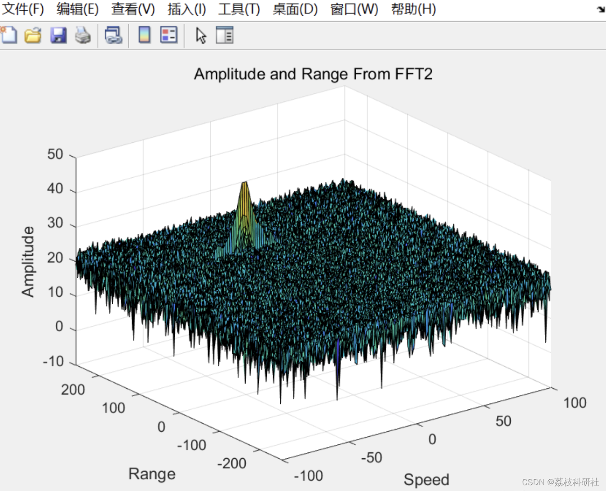
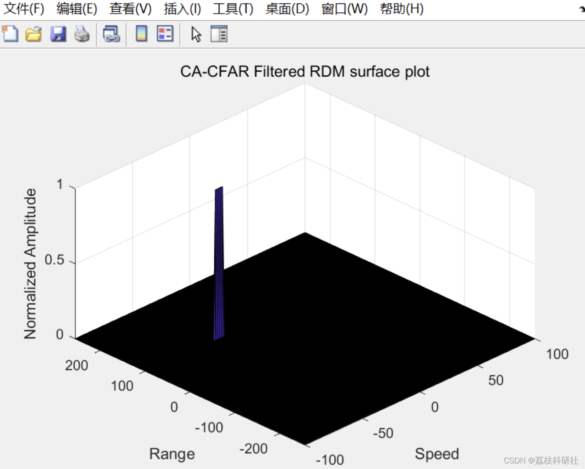
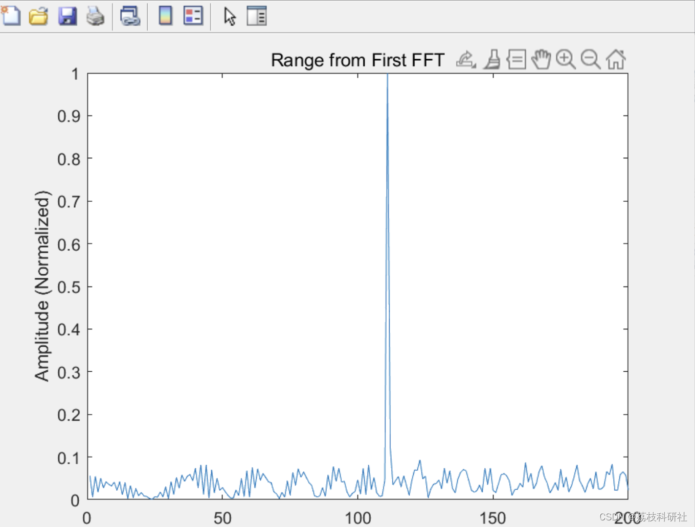

# Radar Detection - Radar Target Detection Technology Based on Complex Environments (Matlab Code Implementation)

​  
📚2 Running Results Editing
Editor
Editor: Partial code:
%% Radar Specifications  
%%%%%%%%%%%%%%%%%%%%%%%%%%%  
% Frequency of operation = 77GHz  
% Max Range = 200m  
% Range Resolution = 1 m  
% Max Velocity = 100 m/s  
%%%%%%%%%%%%%%%%%%%%%%%%%%%  
c = 3e8  
%% User Defined Range and Velocity of target  
% *%TODO* :  
% define the target's initial position and velocity. Note : Velocity  
% remains contant  
range = 110  
vel = -20  
max_range = 200  
range_res = 1  
max_vel = 100 % m/s  
%% FMCW Waveform Generation  
% *%TODO* :  
%Design the FMCW waveform by giving the specs of each of its parameters.  
% Calculate the Bandwidth (B), Chirp Time (Tchirp) and Slope (slope) of the FMCW  
% chirp using the requirements above.  
B = c / (2*range_res)  
Tchirp = 5.5 * 2 * (max_range/c)  
slope = B/Tchirp  
%Operating carrier frequency of Radar  
fc= 77e9;      %carrier freq  
%The number of chirps in one sequence. Its ideal to have 2^ value for the ease of running the FFT  
%for Doppler Estimation.  
Nd=128;         % #of doppler cells OR #of sent periods % number of chirps  
%The number of samples on each chirp.  
Nr=1024;         %for length of time OR # of range cells  
% Timestamp for running the displacement scenario for every sample on each  
% chirp  
t=linspace(0,Nd*Tchirp,Nr*Nd); %total time for samples  
%Creating the vectors for Tx, Rx and Mix based on the total samples input.  
Tx=zeros(1,length(t)); %transmitted signal  
Rx=zeros(1,length(t)); %received signal  
Mix = zeros(1,length(t)); %beat signal  
%Similar vectors for range_covered and time delay.  
r_t=zeros(1,length(t));  
td=zeros(1,length(t));  
%% Signal generation and Moving Target simulation  
% Running the radar scenario over the time.  
for i=1:length(t)  
% *%TODO*  
%For each time stamp update the Range of the Target for constant velocity.  
r_t(i) = range + (vel*t(i));  
td(i) = (2 * r_t(i)) / c;  
% *%TODO* :  
%For each time sample we need update the transmitted and  
%received signal.  
Tx(i) = cos(2*pi*(fc*t(i) + (slope*t(i)^2)/2 ));  
Rx(i) = cos(2*pi*(fc*(t(i) -td(i)) + (slope * (t(i)-td(i))^2)/2 ));  
% TODO:  
% Now by mixing the Transmit and Receive generate the beat signal  
% This is done by element wise matrix multiplication of Transmit and  
% Receiver Signal  
🎉3 References  
🌈4 Matlab code implementation

## Images

<!-- PAYMENT_BLOCK -->

## Get this dataset

- Payment link (Stripe): [Buy now](https://buy.stripe.com/3cs8yP7sY87d0vu9AB)
- Payment QR code: 

<!-- /PAYMENT_BLOCK -->
